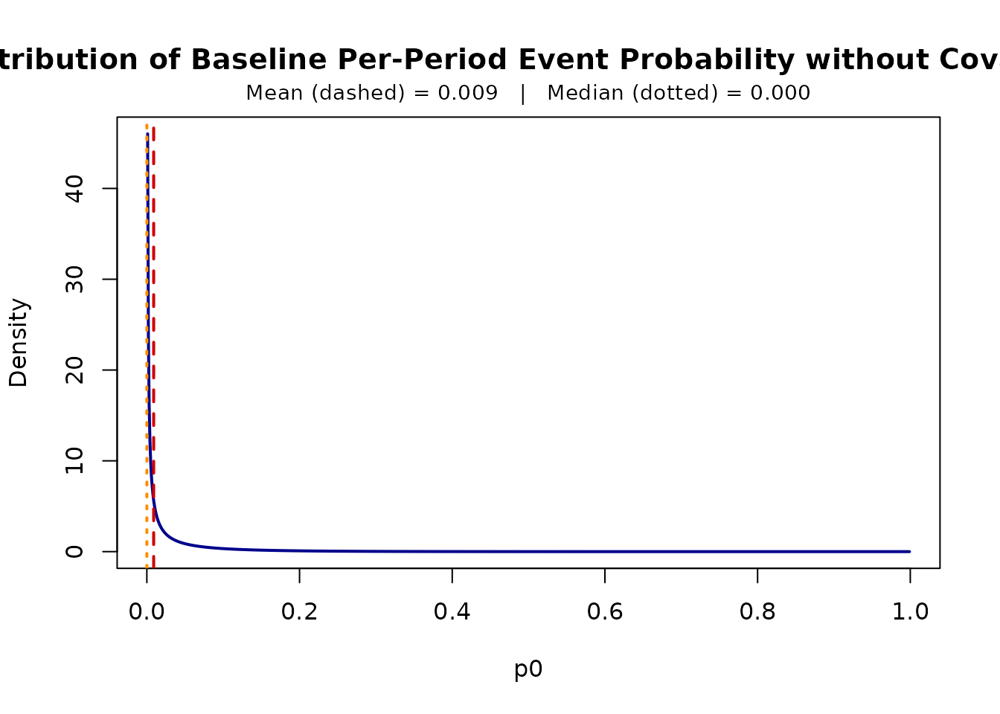
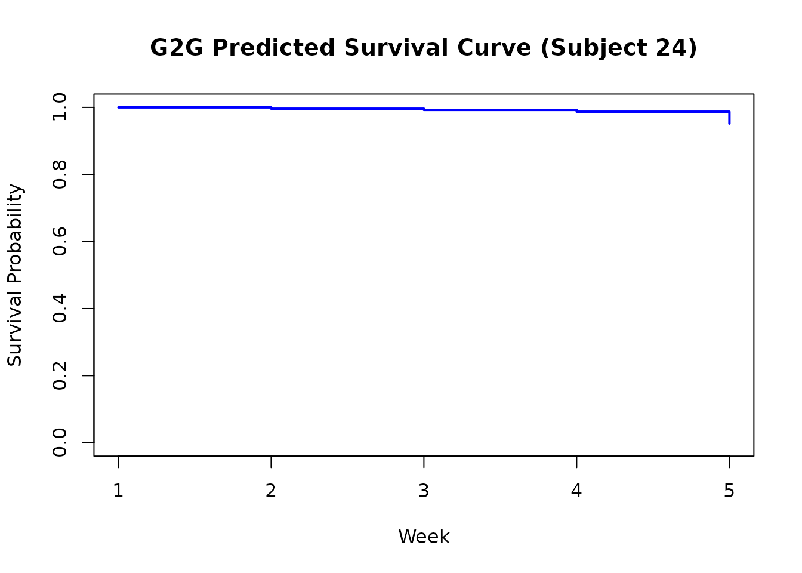
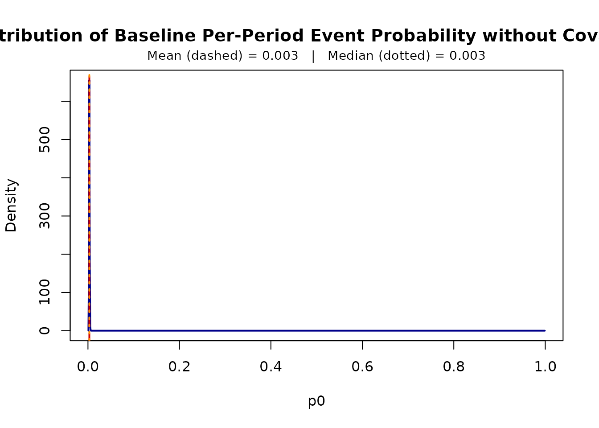
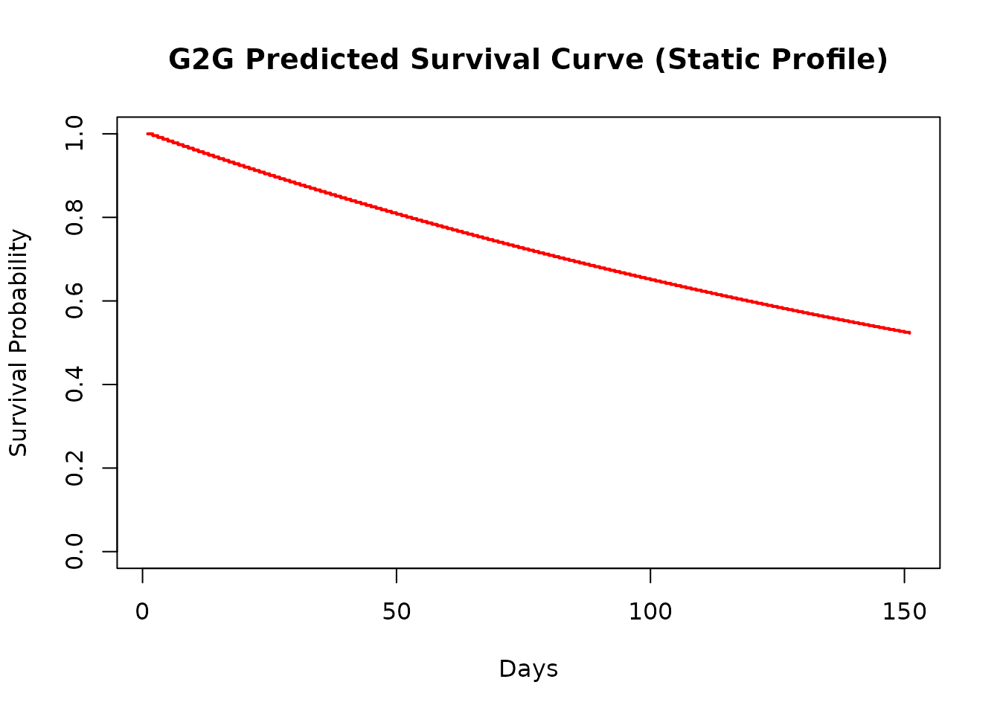

# Introduction to G2Gcov: Discrete-Time Duration Models with Time-Varying Covariates

## Package Overview

`G2Gcov` implements maximum likelihood estimation, diagnostic plotting,
and survival/retention trajectory forecasting of the
Grassia(II)-Geometric (G2G) distribution for discrete-time duration data
with both time-varying and time-invariant covariates and unobserved
cross-sectional heterogeneity, following the methodology of Fader et
al. (2019) and Fader and Hardie (2020).

| Function | Purpose |
|:---|:---|
| [`G2G_varying_MLE()`](https://kaloklee.github.io/G2Gcov/reference/G2G_varying_MLE.md) | Maximum likelihood estimation with time-varying covariates |
| [`G2G_static_MLE()`](https://kaloklee.github.io/G2Gcov/reference/G2G_static_MLE.md) | Maximum likelihood estimation with time-invariant covariates |
| [`print()`](https://rdrr.io/r/base/print.html) | S3 print method displaying estimates, SEs, Wald confidence intervals, and AIC |
| [`plot_p0()`](https://kaloklee.github.io/G2Gcov/reference/plot_p0.md) | Plot baseline per-period event probability density $`p_0`$ across the cohort |
| [`G2G_varying_survival()`](https://kaloklee.github.io/G2Gcov/reference/G2G_varying_survival.md) | Compute discrete-time survival function $`S(t)`$ along dynamic covariate paths |
| [`G2G_varying_retention()`](https://kaloklee.github.io/G2Gcov/reference/G2G_varying_retention.md) | Compute period-to-period retention function $`r(t)`$ along dynamic covariate paths |
| [`G2G_static_survival()`](https://kaloklee.github.io/G2Gcov/reference/G2G_static_survival.md) | Compute discrete-time survival function $`S(t)`$ under static covariates |
| [`G2G_static_retention()`](https://kaloklee.github.io/G2Gcov/reference/G2G_static_retention.md) | Compute period-to-period retention function $`r(t)`$ under static covariates |

------------------------------------------------------------------------

## Time-Varying Covariates in the G2G Model

The G2G model is a discrete-time duration model in which the
individual-level per-period event probability is reparameterized as
$`p_0 = 1 - e^{-\lambda}`$, with
$`\lambda \sim \text{Gamma}(r, \alpha)`$ across subjects to capture
unobserved heterogeneity. Time-varying covariates in period $`j`$,
$`z(j)`$, enter via a complementary log-log link with coefficients
$`\beta'`$,

``` math
p_j = 1 - \exp\left(-\lambda e^{z(j)\beta'}\right),
```

which yields the closed-form survivor function

``` math
S(t) = \left(\frac{\alpha}{\alpha + C(t)}\right)^r, \quad C(t) = \sum_{j=1}^{t} e^{z(j)\beta'}.
```

The probability mass function (PMF) is:

``` math
P(t) = \left(\frac{\alpha}{\alpha + C(t-1)}\right)^r - \left(\frac{\alpha}{\alpha + C(t)}\right)^r
```

The likelihood function simply consists of the PMF and $`S(t)`$ for
uncensored and censored subjects, respectively.

### Required Format for Time-Varying Covariates Data

Data must be in **person-period (long) format**:

- One row per subject per time period.
- A subject identifier column linking rows to the same individual.
- An event indicator equaling 1 in the period the event occurred, and 0
  in all preceding periods. All 0s through the last observed period for
  censored subjects

| Column | Type | Description |
|:---|:---|:---|
| `id` | Identifier | Unique subject identifier (numeric, character, or factor) |
| `week` (or `time`) | Integer | Sequential discrete period index ($`1, 2, 3, \dots`$) |
| `status` | Binary (0/1) | 1 if the event occurred in that specific period; 0 in the preceding periods; all 0s through the last observed period for censored subjects |
| `coupon, anyp, ...` | Numeric / Factor | Dynamic or static covariates (continuous, binary, or multi-level) |

Factor and character covariates are expanded into dummy variables
through standard R formula mechanics (`model.matrix`, treatment
contrasts).

------------------------------------------------------------------------

## Example 1: Time-Varying Covariates (`kb_data`)

> **Note on Datasets:** To ensure this vignette builds rapidly within
> CRAN limits, we evaluate the models using `kb_data_sample`, a
> 20-subject subset of the package’s full data intended for quick trials
> and interactive exploration. For full empirical analyses, simply use
> the entire cohort of 1,499 subjects via `kb_data<-G2Gcov::kb_data`.
> The syntax remains identical.

Each row in the data represents one customer-week. We print the first 50
rows to illustrate the person-period structure required for time-varying
modeling.

``` r

library(G2Gcov)
library(survival)

# Load the quick-start sample dataset
kb_data_sample<-G2Gcov::kb_data_sample

# Inspect the person-period data structure
round(head(kb_data_sample, 50), 2)
#>     id week num_weeks censor coupon  anyp status
#> 1   24    1         4      0   0.00 55.61      0
#> 2   24    2         4      0   0.00 55.82      0
#> 3   24    3         4      0   0.02 55.65      0
#> 4   24    4         4      0   0.13 81.17      1
#> 5   49    1         7      0   0.00 55.61      0
#> 6   49    2         7      0   0.00 55.82      0
#> 7   49    3         7      0   0.02 55.65      0
#> 8   49    4         7      0   0.13 81.17      0
#> 9   49    5         7      0   0.08 74.45      0
#> 10  49    6         7      0   0.04 73.82      0
#> 11  49    7         7      0   0.02 46.83      1
#> 12 165    1        24      0   0.00 55.61      0
#> 13 165    2        24      0   0.00 55.82      0
#> 14 165    3        24      0   0.02 55.65      0
#> 15 165    4        24      0   0.13 81.17      0
#> 16 165    5        24      0   0.08 74.45      0
#> 17 165    6        24      0   0.04 73.82      0
#> 18 165    7        24      0   0.02 46.83      0
#> 19 165    8        24      0   0.01  0.00      0
#> 20 165    9        24      0   0.00 72.41      0
#> 21 165   10        24      0   0.02 71.52      0
#> 22 165   11        24      0   0.11 89.32      0
#> 23 165   12        24      0   0.07 56.05      0
#> 24 165   13        24      0   0.04 12.58      0
#> 25 165   14        24      0   0.02 13.33      0
#> 26 165   15        24      0   0.01 43.31      0
#> 27 165   16        24      0   0.00 41.46      0
#> 28 165   17        24      0   0.00 41.95      0
#> 29 165   18        24      0   0.00 44.47      0
#> 30 165   19        24      0   0.00 22.90      0
#> 31 165   20        24      0   0.00  8.82      0
#> 32 165   21        24      0   0.00  0.00      0
#> 33 165   22        24      0   0.00  0.00      0
#> 34 165   23        24      0   0.00 32.20      0
#> 35 165   24        24      1   0.00 33.40      0
#> 36 321    1        24      0   0.00 55.61      0
#> 37 321    2        24      0   0.00 55.82      0
#> 38 321    3        24      0   0.02 55.65      0
#> 39 321    4        24      0   0.13 81.17      0
#> 40 321    5        24      0   0.08 74.45      0
#> 41 321    6        24      0   0.04 73.82      0
#> 42 321    7        24      0   0.02 46.83      0
#> 43 321    8        24      0   0.01  0.00      0
#> 44 321    9        24      0   0.00 72.41      0
#> 45 321   10        24      0   0.02 71.52      0
#> 46 321   11        24      0   0.11 89.32      0
#> 47 321   12        24      0   0.07 56.05      0
#> 48 321   13        24      0   0.04 12.58      0
#> 49 321   14        24      0   0.02 13.33      0
#> 50 321   15        24      0   0.01 43.31      0
```

We estimate the model by directly supplying the formula and the subject
identifier. Please note that both estimation functions require at least
one covariate on the right-hand side of the formula.

``` r

# Estimate the discrete-time model with dynamic marketing covariates
fit_varying <- G2G_varying_MLE(
  Surv(week, status) ~ coupon + anyp,
  data    = kb_data_sample,
  subject = "id"
)

# View parameter estimates, standard errors, and Wald confidence intervals
print(fit_varying)
#> G2G Model Fit
#> ---------------------------------------------------- 
#> Convergence:       Converged (code 0)
#> Log-likelihood:    -11.1869
#> AIC:               30.3739
#> Parameters:        4
#> 
#> Coefficients:
#>              Estimate Std.Error Lower.95   Upper.95
#> r (shape)      0.0611    0.1047   0.0021     1.7580
#> alpha (rate)   6.3229   31.1821   0.0004 99709.9104
#> coupon        24.9515   22.4348 -19.0199    68.9230
#> anyp          -0.0159    0.0554  -0.1246     0.0927
#> 
#> Warning: Extremely wide confidence intervals for baseline parameters suggest a flat likelihood ridge (common with small sample sizes or few observed events). Interpret estimates and limits with caution.
```

### Interpreting the Coefficients

Each coefficient $`\beta_k`$ acts on the complementary log-log scale, so
$`e^{\beta_k}`$ is a hazard ratio: a one-unit increase in a numeric
covariate, or a switch from the reference level to a given factor level,
multiplies $`\lambda`$ by $`e^{\beta_k}`$. A positive $`\beta_k`$ raises
the per-period event probability (shorter durations); a negative
$`\beta_k`$ lowers it (longer durations).

The baseline per-period event probability, $`p_0 = 1 - e^{-\lambda}`$
with $`\lambda \sim \text{Gamma}(r, \alpha)`$, describes subjects at
zero for numeric covariates and at the reference level of each factor.

Hazard ratios are expressed per unit of each covariate, so raw
coefficients are not comparable across covariates measured on different
scales, such as `coupon` and `anyp`. To make an effect concrete, compute
the hazard ratio for a meaningful change $`\Delta`$,
$`e^{\beta_k \Delta}`$. An effect is distinguishable from zero when the
confidence interval for $`\beta_k`$ excludes $`0`$ (equivalently, when
the interval for the hazard ratio excludes $`1`$).

### Estimation Details

Internally,
[`G2G_varying_MLE()`](https://kaloklee.github.io/G2Gcov/reference/G2G_varying_MLE.md)
applies several techniques to ensure robust numerical optimization:

- **Automatic Standardization:** To improve numerical stability and
  convergence of the BFGS algorithm, all continuous covariates are
  automatically standardized (centered and scaled) prior to maximizing
  the likelihood. Upon convergence, the resulting coefficient estimates
  are dynamically rescaled back to their original metric, ensuring the
  output is immediately interpretable on the scale of the original data.
- **Delta Method for Standard Errors:** The optimization routines
  estimate baseline parameters in an unconstrained space (e.g., using
  $`\log(r)`$ and $`\log(\alpha)`$ to enforce strict positivity
  constraints). The package computes the inverse Hessian matrix and
  applies the multivariate Delta method to derive standard errors on
  their original scale.
- **Wald Confidence Limits:** Using Delta method standard errors, the
  package automatically calculates and reports Wald confidence
  intervals: symmetric for the covariate coefficients, and computed on
  the log scale for $`r`$ and $`\alpha`$ so they remain strictly
  positive. By default, it reports 95% confidence limits, which can be
  modified via the `level` argument (e.g., `level = 0.99`).
- [`G2G_static_MLE()`](https://kaloklee.github.io/G2Gcov/reference/G2G_static_MLE.md)
  applies these same optimization and standardization techniques.

### Visualizations and Projections

We can visualize the implied distribution of the baseline weekly event
probability across the population:

``` r

plot_p0(fit_varying)
```



> **A note on $`r`$ and $`\alpha`$:** The standard errors of $`r`$ and
> $`\alpha`$ can be as large as the estimates themselves, particularly
> in small samples. This is typical of a gamma mixing distribution and
> is not a sign of a problem: the two parameters are often highly
> correlated, because many $`(r, \alpha)`$ combinations imply very
> similar distributions of $`p_0`$. Interpret them jointly, for example
> through the implied distribution of $`p_0`$ shown by
> [`plot_p0()`](https://kaloklee.github.io/G2Gcov/reference/plot_p0.md),
> rather than one at a time.

Next, we extract the survival curve explicitly using
[`G2G_varying_survival()`](https://kaloklee.github.io/G2Gcov/reference/G2G_varying_survival.md)
by passing a specific customer’s covariate path, and plot the predicted
step-function. The length of the generated survival curve aligns with
the length of the covariate path provided:

``` r

# Predict individual survival curve S(t) along a specific customer trajectory
# (Subject 24 is included in our sample)
customer_path <- kb_data_sample[kb_data_sample$id == 24, c("coupon", "anyp")]

# Compute the survival curve predictions explicitly
surv_est <- G2G_varying_survival(solution = fit_varying, X_mat = customer_path)

# Plot the predicted survival curve using base R graphics
plot(
  seq_along(surv_est), 
  surv_est, 
  type = "s",  # Step function for discrete time
  col  = "blue", 
  lwd  = 2,
  xlab = "Week", 
  ylab = "Survival Probability",
  main = "G2G Predicted Survival Curve (Subject 24)",
  ylim = c(0, 1)
)
```



We can also project conditional period-to-period retention function,
defined as $`r(t) = S(t)/S(t-1)`$, along that same dynamic customer path
using
[`G2G_varying_retention()`](https://kaloklee.github.io/G2Gcov/reference/G2G_varying_retention.md):

``` r

# Compute period-to-period retention r(t) = S(t)/S(t-1)
ret_est <- G2G_varying_retention(solution = fit_varying, X_mat = customer_path)

# Display 
head(data.frame(Week = seq_along(ret_est), Retention = round(ret_est, 4)))
#>   Week Retention
#> 1    1    1.0000
#> 2    2    0.9961
#> 3    3    0.9964
#> 4    4    0.9947
#> 5    5    0.9640
```

------------------------------------------------------------------------

## Example 2: Static Covariate Baseline (`survival::veteran`)

If covariates are fixed for each subject, the cumulative hazard
simplifies.
[`G2G_static_MLE()`](https://kaloklee.github.io/G2Gcov/reference/G2G_static_MLE.md)
handles data in traditional cross-sectional format (one row per subject)
and automatically manages factor variables like `celltype`. We
demonstrate this using the
[`survival::veteran`](https://rdrr.io/pkg/survival/man/veteran.html)
dataset.

``` r

vet <- survival::veteran
```

``` r

# Using a 99% confidence limits in this example
fit_static <- G2G_static_MLE(
  Surv(time, status) ~ age + celltype,
  data  = vet,
  level = 0.99
)

# View parameter estimates and model convergence for the static baseline
print(fit_static)
#> G2G Model Fit
#> ---------------------------------------------------- 
#> Convergence:       Converged (code 0)
#> Log-likelihood:    -733.1773
#> AIC:               1478.3546
#> Parameters:        6
#> 
#> Coefficients:
#>                    Estimate  Std.Error Lower.99     Upper.99
#> r (shape)           24.4605    65.4851   0.0248 2.417343e+04
#> alpha (rate)      8031.0071 23544.1149   4.2191 1.528679e+07
#> age                  0.0074     0.0097  -0.0175 3.230000e-02
#> celltypesmallcell    1.0711     0.2450   0.4401 1.702200e+00
#> celltypeadeno        1.2015     0.2819   0.4753 1.927800e+00
#> celltypelarge        0.2415     0.2840  -0.4900 9.730000e-01
#> 
#> Warning: Extremely wide confidence intervals for baseline parameters suggest a flat likelihood ridge (common with small sample sizes or few observed events). Interpret estimates and limits with caution.
```

We plot the baseline event probability distribution at reference
covariate values (squamous cell type and age = 0). The first level of a
factor is its reference category (here `squamous`). For `character`
vectors, the first level is the alphabetically first value; use
[`relevel()`](https://rdrr.io/r/stats/relevel.html) or
`factor(x, levels = ...)` to choose a different reference:

``` r

plot_p0(fit_static)
```



Just like the time-varying model, we can project survival and period
retention for a specific profile (passing original factor levels) using
[`G2G_static_survival()`](https://kaloklee.github.io/G2Gcov/reference/G2G_static_survival.md)
and
[`G2G_static_retention()`](https://kaloklee.github.io/G2Gcov/reference/G2G_static_retention.md).
In this situation, we can also specify the length of these functions to
be generated:

``` r

# Predict survival up to t = 150 days for a 49-year-old with squamous cell cancer
surv_static <- G2G_static_survival(
  fit_static, 
  data.frame(age = 49, celltype = "squamous"), 
  150
)

plot(
  seq_along(surv_static),
  surv_static,
  type = "s",
  col  = "red",
  lwd  = 2,
  xlab = "Days",
  ylab = "Survival Probability",
  main = "G2G Predicted Survival Curve (Static Profile)",
  ylim = c(0, 1)
)
```



``` r

# Predict period-to-period retention across the first 10 days
ret_static <- G2G_static_retention(
  fit_static, 
  data.frame(age = 49, celltype = "squamous"), 
  10
)

data.frame(Day = seq_along(ret_static), Retention = round(ret_static, 4))
#>    Day Retention
#> 1    1    1.0000
#> 2    2    0.9956
#> 3    3    0.9956
#> 4    4    0.9956
#> 5    5    0.9956
#> 6    6    0.9956
#> 7    7    0.9956
#> 8    8    0.9956
#> 9    9    0.9956
#> 10  10    0.9956
#> 11  11    0.9956
```

------------------------------------------------------------------------

## References

- Fader, P. S., Hardie, B. G. S., McCarthy, D., & Vaidyanathan, R.
  (2019). Exploring the equivalence of two common mixture models for
  duration data. *The American Statistician*, 73(3), 288–295.
- Fader, P. S., & Hardie, B. G. S. (2020). *Incorporating time-varying
  covariates in a simple mixture model for discrete-time duration data*
  (Research Note No. 037).
  <https://brucehardie.com/notes/037/time-varying_covariates_in_BG.pdf>

------------------------------------------------------------------------

## Session Information

``` r

sessionInfo()
#> R version 4.6.2 (2026-10-29)
#> Platform: x86_64-pc-linux-gnu
#> Running under: Ubuntu 24.04.5 LTS
#> 
#> Matrix products: default
#> BLAS:   /usr/lib/x86_64-linux-gnu/openblas-pthread/libblas.so.3 
#> LAPACK: /usr/lib/x86_64-linux-gnu/openblas-pthread/libopenblasp-r0.3.26.so;  LAPACK version 3.12.0
#> 
#> locale:
#>  [1] LC_CTYPE=C.UTF-8       LC_NUMERIC=C           LC_TIME=C.UTF-8       
#>  [4] LC_COLLATE=C.UTF-8     LC_MONETARY=C.UTF-8    LC_MESSAGES=C.UTF-8   
#>  [7] LC_PAPER=C.UTF-8       LC_NAME=C              LC_ADDRESS=C          
#> [10] LC_TELEPHONE=C         LC_MEASUREMENT=C.UTF-8 LC_IDENTIFICATION=C   
#> 
#> time zone: UTC
#> tzcode source: system (glibc)
#> 
#> attached base packages:
#> [1] stats     graphics  grDevices utils     datasets  methods   base     
#> 
#> other attached packages:
#> [1] survival_3.8-12 G2Gcov_0.1.0   
#> 
#> loaded via a namespace (and not attached):
#>  [1] cli_3.6.6         knitr_1.52        rlang_1.3.0       xfun_0.62        
#>  [5] otel_0.2.0        textshaping_1.0.5 jsonlite_2.0.0    htmltools_0.5.9  
#>  [9] ragg_1.5.2        sass_0.4.10       rmarkdown_2.32    grid_4.6.2       
#> [13] evaluate_1.0.5    jquerylib_0.1.4   fastmap_1.2.0     yaml_2.3.12      
#> [17] lifecycle_1.0.5   compiler_4.6.2    fs_2.1.0          lattice_0.23-1   
#> [21] systemfonts_1.3.2 digest_0.6.39     R6_2.6.1          splines_4.6.2    
#> [25] bslib_0.12.0      Matrix_1.7-6      tools_4.6.2       pkgdown_2.2.1    
#> [29] cachem_1.1.0      desc_1.4.3
```
