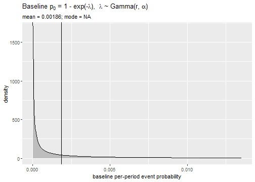
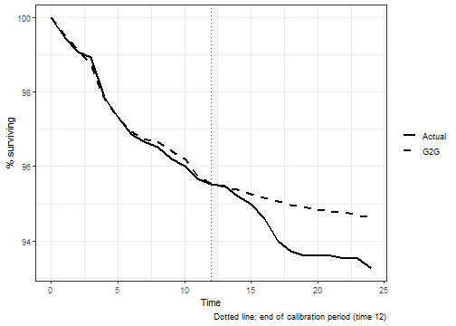
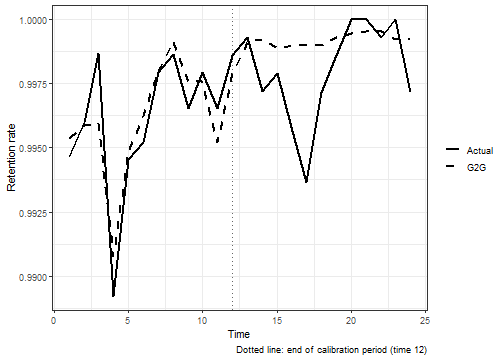
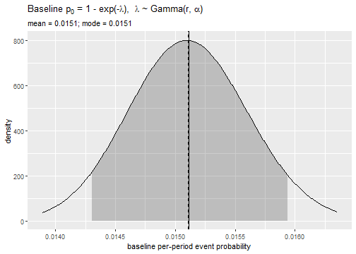
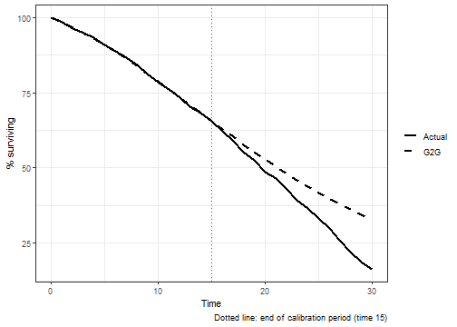
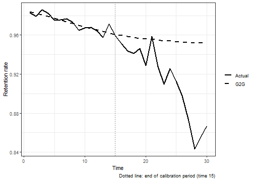

<!--
This vignette fits several models and takes minutes to run, so it is
precomputed. Edit time-varying-introduction.Rmd.orig (the live source), then
run source("vignettes/precompile.R") from the package root to regenerate
time-varying-introduction.Rmd and its figures. Do not edit the generated .Rmd.
-->


## Time-Varying Covariates in the G2G Model

The standard G2G model assumes that covariate values are fixed for each
subject. The time-varying extension replaces the static covariate effect
$C = \exp(\mathbf{x}'\boldsymbol{\beta})$ with a cumulative sum over
period-specific values:

$$C(t) = \sum_{s=1}^{t} \exp\!\left(\mathbf{x}(s)'\boldsymbol{\beta}\right)$$

The survivor function remains $S(t) = \bigl(1 + C(t)/\alpha\bigr)^{-r}$, but
now evolves with the covariate path of each subject. This accommodates
marketing interventions, clinical treatment changes, or any predictor that
varies week-to-week or period-to-period.

### Required Data Format

Data must be in **person-period (long) format**:

- One row per subject per time period
- A subject identifier column linking rows to the same individual
- The event indicator equals 1 in the period the event occurred, 0 in all
  other periods (including the final period for censored subjects)

---

## Example 1: Customer Churn (`kb_data`)

The `kb_data` dataset included in the package tracks weekly covariate values
for a panel of customers. Each row is one customer-week. This example shows
the typical marketing application: do coupon activity and trade promotions
affect the weekly probability of churn?


``` r
library(G2Gcov)
library(survival)
```


``` r
kb_data <- G2Gcov::kb_data
head(kb_data)
#>   id week num_weeks censor coupon  anyp
#> 1  1    1         1      0      0 55.61
#> 2  2    1         1      0      0 55.61
#> 3  3    1         1      0      0 55.61
#> 4  4    1         1      0      0 55.61
#> 5  5    1         1      0      0 55.61
#> 6  6    1         1      0      0 55.61
```

| Variable    | Description |
|-------------|-------------|
| `id`        | Customer identifier |
| `week`      | Week number |
| `num_weeks` | Total weeks observed |
| `censor`    | 1 on the final row of a subject still active at the end of observation; 0 otherwise |
| `coupon`    | Coupon stock covariate (time-varying) |
| `anyp`      | Trade-promotions covariate (time-varying) |

### Data Preparation

The model needs a `status` column that is 1 only in the week a subject's
event occurs and 0 in every other week. In `kb_data`, a subject's event
happened in their final observed week (`week == num_weeks`) unless that row
is marked as censored (`censor == 1`):


``` r
kb_data$status <- as.integer(kb_data$week == kb_data$num_weeks &
                               kb_data$censor == 0)

n_subjects <- length(unique(kb_data$id))
n_events   <- sum(tapply(kb_data$status, kb_data$id, max))

cat("Subjects:        ", n_subjects, "\n")
#> Subjects:         1499
cat("Churned:         ", n_events, "\n")
#> Churned:          101
cat("Censored:        ", n_subjects - n_events, "\n")
#> Censored:         1398
cat("Total obs. rows: ", nrow(kb_data), "\n")
#> Total obs. rows:  34506
```

### Fitting the Model


``` r
fit_full <- G2G_varying_MLE(
  fo      = Surv(week, status) ~ coupon + anyp,
  data    = kb_data,
  subject = "id"
)

cat("Convergence:", fit_full$convergence,
    ifelse(fit_full$convergence == 0, "(converged)", "(check starting values)"), "\n")
#> Convergence: 0 (converged)
cat("Negative log-likelihood:", round(fit_full$value, 2), "\n")
#> Negative log-likelihood: 674.01
```

### Parameter Estimates


``` r
results <- data.frame(
  Parameter = names(fit_full$par),
  Estimate  = fit_full$par,
  SE        = fit_full$par_stderr,
  CI_Lower  = fit_full$par_lower,
  CI_Upper  = fit_full$par_upper,
  row.names = NULL
)
knitr::kable(
  results,
  digits    = 3,
  col.names = c("Parameter", "Estimate", "Std. Error",
                "Lower 95% CI", "Upper 95% CI"),
  caption   = "G2G parameter estimates -- kb_data (full model)"
)
```


Table: G2G parameter estimates -- kb_data (full model)

|Parameter    | Estimate| Std. Error| Lower 95% CI| Upper 95% CI|
|:------------|--------:|----------:|------------:|------------:|
|r (shape)    |    0.103|      0.064|        0.031|        0.347|
|alpha (rate) |   54.959|     54.806|        7.784|      388.043|
|coupon       |    2.322|      2.967|       -3.493|        8.136|
|anyp         |    0.015|      0.006|        0.003|        0.027|


**Interpreting the estimates:**

- **r** and **alpha** define the Gamma distribution of the baseline weekly
  event rate $\lambda$; the baseline weekly event probability is
  $p_0 = 1 - e^{-\lambda}$.
- **coupon** and **anyp** are log-hazard coefficients. A positive coefficient
  means higher covariate values increase the churn hazard in that period.

### Hazard Ratios


``` r
coef_idx <- seq_along(fit_full$par)[-(1:2)]
hr_df <- data.frame(
  Covariate   = names(fit_full$par)[coef_idx],
  Coefficient = fit_full$par[coef_idx],
  HR          = exp(fit_full$par[coef_idx]),
  Direction   = ifelse(fit_full$par[coef_idx] > 0,
                       "Increases churn", "Decreases churn"),
  row.names   = NULL
)
knitr::kable(
  hr_df,
  digits    = 3,
  col.names = c("Covariate", "Coefficient", "Hazard Ratio", "Direction"),
  caption   = "Covariate hazard ratios"
)
```


Table: Covariate hazard ratios

|Covariate | Coefficient| Hazard Ratio|Direction       |
|:---------|-----------:|------------:|:---------------|
|coupon    |       2.322|       10.192|Increases churn |
|anyp      |       0.015|        1.015|Increases churn |


### Model Comparison and Likelihood Ratio Tests


``` r
fit_coupon <- G2G_varying_MLE(
  fo = Surv(week, status) ~ coupon, data = kb_data, subject = "id"
)
fit_anyp <- G2G_varying_MLE(
  fo = Surv(week, status) ~ anyp,   data = kb_data, subject = "id"
)

# LRT = 2 * (logLik_full - logLik_reduced); $value is the negative log-likelihood
lrt_coupon <- 2 * (fit_anyp$value   - fit_full$value)
lrt_anyp   <- 2 * (fit_coupon$value - fit_full$value)

lrt_df <- data.frame(
  Covariate = c("coupon", "anyp"),
  LRT       = c(lrt_coupon, lrt_anyp),
  df        = c(1L, 1L),
  p_value   = c(pchisq(lrt_coupon, 1, lower.tail = FALSE),
                pchisq(lrt_anyp,   1, lower.tail = FALSE)),
  row.names = NULL
)
knitr::kable(
  lrt_df,
  digits    = c(0, 3, 0, 4),
  col.names = c("Dropped covariate", "LRT statistic", "df", "p-value"),
  caption   = "Likelihood ratio tests (full vs. reduced)"
)
```


Table: Likelihood ratio tests (full vs. reduced)

|Dropped covariate | LRT statistic| df| p-value|
|:-----------------|-------------:|--:|-------:|
|coupon            |         0.602|  1|  0.4379|
|anyp              |         6.239|  1|  0.0125|


### Visualizations


``` r
plot_p0(fit_full)
```




``` r
out_kb <- plot_insample_holdout_paper(
  fo       = Surv(week, status) ~ coupon + anyp,
  data     = kb_data,
  subject  = "id",
  split_at = 12L
)
print(out_kb$p_survival)
```



``` r
print(out_kb$p_retention)
```



The dotted vertical line marks the end of the calibration period at week 12.
G2G predictions beyond this line are hold-out forecasts based solely on
parameters estimated from the first 12 weeks. The model's retention rate in
each week is the average model-implied retention of the subjects still at risk
that week, and the G2G survival curve chains these rates together in the same
way the Kaplan-Meier curve chains the observed ones.

---

## Example 2: Historical Mortality (Scania)

This example demonstrates that `G2G_varying_MLE()` generalizes beyond
marketing data to historical demographic data. The `scania` dataset from the
`eha` package (Broström, 2012) records the mortality of 1,931 people in
19th-century Sweden, followed from age 50. It combines two time-invariant
covariates (`sex`, `immigrant`) with two time-varying ones: the annual log
rye price (`foodprices`), a proxy for nutritional stress that changes each
calendar year, and age, which increases by one every period.


``` r
scania <- eha::scania
logrye <- eha::logrye
```

### Data Description

The `scania` dataset is in individual-level (short) format — one row per
person. The `logrye` dataset contains one row per calendar year with the
log rye price for that year.

| Variable     | Source    | Type           | Description |
|--------------|-----------|----------------|-------------|
| `id`         | `scania`  | Time-invariant | Individual identifier |
| `sex`        | `scania`  | Time-invariant | Sex (female / male) |
| `immigrant`  | `scania`  | Time-invariant | Immigrant status (yes / no) |
| `event`      | `scania`  | Outcome        | 1 = died, 0 = censored |
| `foodprices` | `logrye`  | Time-varying   | Log rye price for that calendar year |
| `age10`      | derived   | Time-varying   | Decades since age 50, i.e. (age - 50) / 10 |

### Data Preparation

The `scania` data is in individual-level (short) format and must be converted
to person-period (long) format before fitting. We center observation time at
age 50 so that period 1 represents the first year of risk at or after age 50.
Each individual's `spell` is their total years of observation.


``` r
sc <- scania
sc$exit      <- ceiling(sc$exit)
sc$birthdate <- floor(sc$birthdate)
sc$spell     <- sc$exit - sc$enter
sc$enter     <- sc$enter - 50L
sc$exit      <- sc$exit  - 50L
sc           <- sc[sc$spell >= 1L, ]

cat("Individuals:", nrow(sc), "  Events:", sum(sc$event), "\n")
#> Individuals: 1931   Events: 1086
```

We expand to person-period format using a base R helper, then join the annual
food price. Each subject gets one row per year of observation. The event
indicator is 1 only in the final row for subjects who died; all other rows
are 0.


``` r
# Expand individual-level data to one row per subject per period
to_person_period <- function(data, time_col, event_col) {
  rows <- lapply(seq_len(nrow(data)), function(i) {
    spell <- data[[time_col]][i]
    if (is.na(spell) || spell < 1L) return(NULL)
    df         <- data[rep(i, spell), , drop = FALSE]
    df$timeInt <- seq_len(spell)
    df$y       <- c(rep(0L, spell - 1L), as.integer(data[[event_col]][i]))
    row.names(df) <- NULL
    df
  })
  do.call(rbind, rows)
}

sc_pp        <- to_person_period(sc, time_col = "spell",
                                 event_col = "event")
sc_pp$event  <- sc_pp$y
sc_pp$exit   <- sc_pp$timeInt
sc_pp$enter  <- sc_pp$exit - 1L
sc_pp$age    <- sc_pp$enter + 50L

# Calendar year = birth year + age; join annual food prices
sc_pp$year   <- sc_pp$age + floor(sc_pp$birthdate)
sc_pp        <- merge(sc_pp, logrye, by = "year", all.x = TRUE)
sc_pp        <- sc_pp[, c("id", "enter", "exit", "event",
                           "sex", "immigrant", "age", "year", "foodprices")]

# Age in decades since 50, so that exp(beta * age10) stays on a moderate scale
sc_pp$age10  <- (sc_pp$age - 50) / 10

cat("Person-period rows:", nrow(sc_pp), "\n")
#> Person-period rows: 27877
head(sc_pp)
#>     id enter exit event    sex immigrant age year foodprices age10
#> 1 1722     0    1     0   male        no  50 1813      0.081     0
#> 2 1094     0    1     0   male        no  50 1813      0.081     0
#> 3 1761     0    1     0   male        no  50 1813      0.081     0
#> 4 1408     0    1     0   male        no  50 1813      0.081     0
#> 5  868     0    1     0 female        no  50 1813      0.081     0
#> 6 1767     0    1     0   male       yes  50 1813      0.081     0
```

### Fitting the Model

Mortality after age 50 rises steadily with age. In the G2G model, a
subject's hazard changes over time only through the covariates, so age has
to enter the model as a time-varying covariate for the fitted hazard to
increase with age. We therefore fit `sex`, `immigrant`, `foodprices`, and
`age10`, while the Gamma frailty (r, alpha) captures unobserved
heterogeneity in baseline mortality propensity across individuals.


``` r
fit_sc <- G2G_varying_MLE(
  fo      = Surv(exit, event) ~ sex + immigrant + foodprices + age10,
  data    = sc_pp,
  subject = "id"
)

cat("Convergence:", fit_sc$convergence,
    ifelse(fit_sc$convergence == 0, "(converged)", "(check starting values)"), "\n")
#> Convergence: 0 (converged)
cat("Negative log-likelihood:", round(fit_sc$value, 2), "\n")
#> Negative log-likelihood: 4381.81
```

### Parameter Estimates


``` r
results_sc <- data.frame(
  Parameter = names(fit_sc$par),
  Estimate  = fit_sc$par,
  SE        = fit_sc$par_stderr,
  CI_Lower  = fit_sc$par_lower,
  CI_Upper  = fit_sc$par_upper,
  row.names = NULL
)
# Three significant digits per cell, so the very large r and alpha bounds do
# not force the whole column into scientific notation
results_sc[-1] <- lapply(results_sc[-1], function(v)
  formatC(v, digits = 3, format = "fg", big.mark = ","))
knitr::kable(
  results_sc,
  align     = "lrrrr",
  col.names = c("Parameter", "Estimate", "Std. Error",
                "Lower 95% CI", "Upper 95% CI"),
  caption   = "G2G parameter estimates -- Scania"
)
```


Table: G2G parameter estimates -- Scania

|Parameter    | Estimate| Std. Error| Lower 95% CI|        Upper 95% CI|
|:------------|--------:|----------:|------------:|-------------------:|
|r (shape)    |      903|      9,923|  0.000000394|   2,065,257,766,671|
|alpha (rate) |   59,268|    651,524|     0.000026| 134,938,807,617,585|
|sexfemale    |   0.0412|     0.0607|      -0.0779|                0.16|
|immigrantyes |   0.0311|     0.0613|      -0.0891|               0.151|
|foodprices   |    0.365|      0.183|      0.00639|               0.724|
|age10        |    0.765|     0.0378|         0.69|               0.839|


The estimates of r and alpha are both very large and very imprecise. The
Gamma distribution then has variance $r / \alpha^2$ close to zero, meaning
that once age and the other covariates are accounted for, the data show
little unobserved heterogeneity in baseline mortality. The covariate
coefficients remain well determined.

### Hazard Ratios

Exponentiate covariate coefficients to obtain hazard ratios — the
multiplicative change in period mortality hazard for a one-unit increase in
each predictor.


``` r
coef_idx_sc <- seq_along(fit_sc$par)[-(1:2)]
hr_sc <- data.frame(
  Covariate   = names(fit_sc$par)[coef_idx_sc],
  Coefficient = fit_sc$par[coef_idx_sc],
  HR          = exp(fit_sc$par[coef_idx_sc]),
  row.names   = NULL
)
knitr::kable(
  hr_sc,
  digits    = 3,
  col.names = c("Covariate", "Coefficient", "Hazard Ratio"),
  caption   = "Covariate hazard ratios -- Scania"
)
```


Table: Covariate hazard ratios -- Scania

|Covariate    | Coefficient| Hazard Ratio|
|:------------|-----------:|------------:|
|sexfemale    |       0.041|        1.042|
|immigrantyes |       0.031|        1.032|
|foodprices   |       0.365|        1.440|
|age10        |       0.765|        2.148|


A hazard ratio above 1 increases mortality risk; below 1 decreases it. The
`age10` ratio is the multiplicative increase in the annual mortality hazard
per decade of age. The `foodprices` coefficient captures whether higher
annual food prices — a proxy for nutritional scarcity — were associated with
elevated mortality in that year.

### Visualizations

`plot_p0()` shows the distribution of the baseline annual probability of
death implied by the fitted Gamma distribution. Here it is narrow, reflecting
the small amount of unobserved heterogeneity noted above.


``` r
plot_p0(fit_sc)
```



As with `kb_data`, `plot_insample_holdout_paper()` fits the model on a
calibration window, here the first 15 years after age 50, and compares the
model with the Kaplan-Meier curve over the full 30 years.


``` r
out_sc <- plot_insample_holdout_paper(
  fo       = Surv(exit, event) ~ sex + immigrant + foodprices + age10,
  data     = sc_pp,
  subject  = "id",
  split_at = 15L
)
print(out_sc$p_survival)
```



``` r
print(out_sc$p_retention)
```



The model tracks the calibration period closely. In the hold-out years it
increasingly under-predicts deaths: mortality at advanced ages accelerates
faster than the model, estimated on ages 50 to 65 alone, extrapolates.

---

## References

Broström, G. (2012). *Event History Analysis with R*. Chapman & Hall/CRC.

Fader, P.S. and Hardie, B.G.S. (1997). How to project customer retention.
*Journal of Interactive Marketing*, 11(1), 61--73.

Fader, P.S. and Hardie, B.G.S. (2007). How to project customer retention
revisited: The role of duration dependence.
*Journal of Interactive Marketing*, 21(1), 76--90.
<https://doi.org/10.1002/dir.20074>

Grassia, A. (1977). On a family of distributions with argument between 0 and
1 obtained by transformation of the Gamma distribution and derived compound
distributions. *Australian Journal of Statistics*, 19(2), 108--114.
<https://doi.org/10.1111/j.1467-842X.1977.tb01277.x>

Schmittlein, D.C., Morrison, D.G. and Colombo, R. (1987). Counting your
customers: Who are they and what will they do next?
*Management Science*, 33(1), 1--24.
<https://doi.org/10.1287/mnsc.33.1.1>

## Session Information


``` r
sessionInfo()
#> R version 4.5.2 (2025-10-31 ucrt)
#> Platform: x86_64-w64-mingw32/x64
#> Running under: Windows 11 x64 (build 26300)
#> 
#> Matrix products: default
#>   LAPACK version 3.12.1
#> 
#> locale:
#> [1] LC_COLLATE=English_United States.utf8 
#> [2] LC_CTYPE=English_United States.utf8   
#> [3] LC_MONETARY=English_United States.utf8
#> [4] LC_NUMERIC=C                          
#> [5] LC_TIME=English_United States.utf8    
#> 
#> time zone: America/New_York
#> tzcode source: internal
#> 
#> attached base packages:
#> [1] stats     graphics  grDevices utils     datasets  methods   base     
#> 
#> other attached packages:
#> [1] survival_3.8-3 G2Gcov_0.1.0  
#> 
#> loaded via a namespace (and not attached):
#>  [1] Matrix_1.7-4       gtable_0.3.6       dplyr_1.2.1        compiler_4.5.2    
#>  [5] tidyselect_1.2.1   eha_2.12.0         dichromat_2.0-0.1  callr_3.7.6       
#>  [9] splines_4.5.2      scales_1.4.0       fastmap_1.2.0      lattice_0.22-7    
#> [13] ggplot2_4.0.3      R6_2.6.1           labeling_0.4.3     generics_0.1.4    
#> [17] knitr_1.50         tibble_3.3.0       desc_1.4.3         pillar_1.11.1     
#> [21] RColorBrewer_1.1-3 rlang_1.2.0        cachem_1.1.0       xfun_0.54         
#> [25] fs_1.6.6           S7_0.2.2           pkgload_1.4.1      memoise_2.0.1     
#> [29] cli_3.6.5          withr_3.0.2        magrittr_2.0.4     ps_1.9.1          
#> [33] grid_4.5.2         processx_3.8.6     remotes_2.5.0      devtools_2.4.6    
#> [37] lifecycle_1.0.5    vctrs_0.7.3        evaluate_1.0.5     glue_1.8.1        
#> [41] farver_2.1.2       sessioninfo_1.2.3  pkgbuild_1.4.8     purrr_1.2.0       
#> [45] tools_4.5.2        usethis_3.2.1      pkgconfig_2.0.3    ellipsis_0.3.2
```
